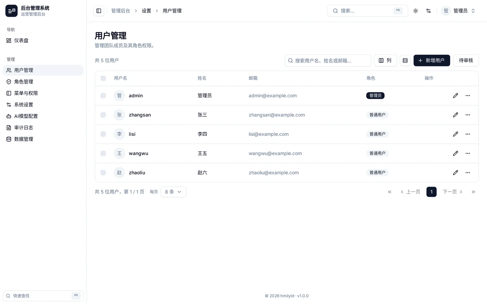
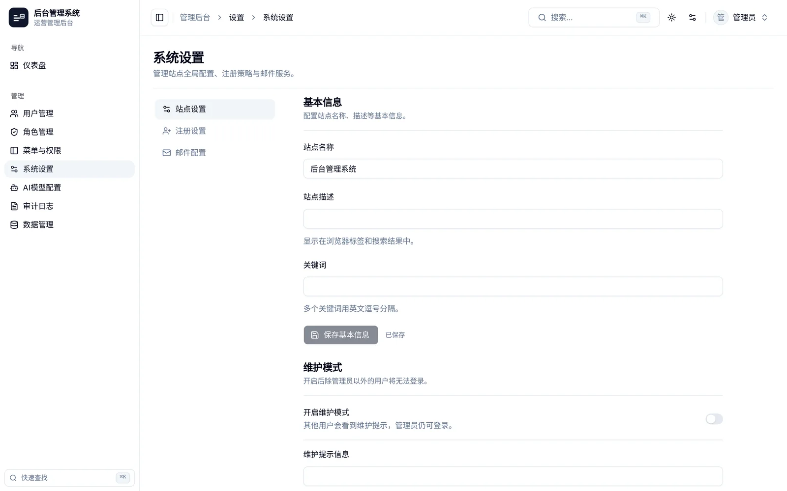
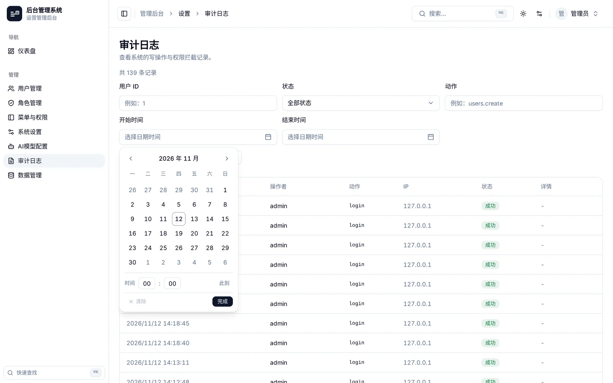
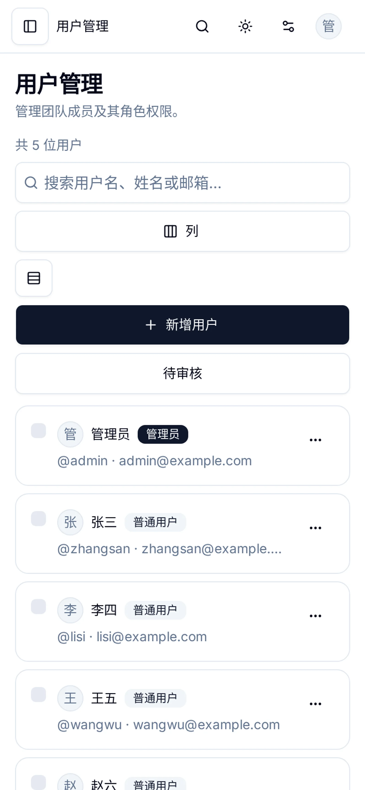

# 全栈工坊 · Fullstack Forge

**一行命令，生成一套能直接上线的后台系统。** 前端 React / Vue / Svelte 任选，后端 FastAPI / Spring Boot 任选，六种组合得到同一套界面、同一套接口约定。

[create-fullstack-app](https://github.com/hmilyld/fullstack-starter) 是生成器，也是这些模板的维护仓库 —— 模板本身就是一个个可独立运行、可独立部署的完整项目。


## 六种组合，自由选择

| | Python · FastAPI | Java · Spring Boot |
|---|---|---|
| **React 19** | React + Vite + Tailwind v4 + shadcn/ui ／ FastAPI + SQLAlchemy 2 + Alembic | React + Vite + Tailwind v4 + shadcn/ui ／ Spring Boot 3 + JPA + Flyway |
| **Vue 3** | Vue 3 + Vite + Tailwind v4 + shadcn-vue ／ FastAPI + SQLAlchemy 2 + Alembic | Vue 3 + Vite + Tailwind v4 + shadcn-vue ／ Spring Boot 3 + JPA + Flyway |
| **Svelte 5** | SvelteKit 3 + Vite + Tailwind v4 + shadcn-svelte ／ FastAPI + SQLAlchemy 2 + Alembic | SvelteKit 3 + Vite + Tailwind v4 + shadcn-svelte ／ Spring Boot 3 + JPA + Flyway |

六条路线共用**同一份接口契约**（`docs/contract/api.md`）、同一套权限目录、同一套视觉规范。所以：

- 换前端不换后端：同一份 FastAPI 服务可以接 React、Vue 或 Svelte 模板，接口、字段、错误码完全一致
- 换后端不换前端：前端只认 `{ code, message, data }` 信封，Python 与 Java 实现可互换
- 三套前端保持像素级、交互级同步：同样的布局、同样的组件、同样的键盘操作

## 生成出来的是什么

不是空壳。每个项目开箱就有认证、RBAC 权限、菜单管理、审计、数据管理与仪表盘，默认账号 `admin / 123456` 即可登录。

| 登录 | 用户管理 |
|---|---|
|  |  |

| 系统设置（左侧导航 + 表单） | 审计日志（中文日期选择器） |
|---|---|
|  |  |

深色模式与多端适配都是内置的，不是附加项：

| 深色模式 | 平板（图标栏） | 手机（卡片列表） |
|---|---|---|
|  |  |  |

## 内置能力

- **认证与安全**：登录 / 注册 / 登出（Python 走 JWT 且登出即失效，Java 走 Sa-Token 会话）、登录注册限流、维护模式、人工审核、401 自动登出
- **RBAC 权限**：权限码驱动，支持菜单级与操作级授权；权限与菜单由代码目录（catalog）同步，Python / Java 两份目录内置校验防止漂移
- **菜单管理**：树形维护、跨组拖拽、拖拽即保存、显示/隐藏、按权限动态生成侧边栏
- **用户 / 角色**：CRUD、分页搜索、批量改角色、重置密码、删除角色时用户自动转交默认角色
- **系统设置**：站点配置、邮件测试、开放注册、维护模式、人工审核
- **AI 模型**：模型与预设管理、连接测试、按别名查询默认模型
- **审计日志**：写操作与权限拦截留痕，按用户 / 状态 / 动作 / 时间筛选
- **数据管理**：AES 加密完整导出、同版本完整导入、导入期冻结、导入后强制重新登录
- **列表体验**：列显隐与表格密度按表记忆、每页条数、表头吸顶、多选批量操作、手机卡片列表
- **交互细节**：⌘K 命令面板（含最近访问）、外观抽屉（主题 / 侧栏样式）、表单未保存离开提示
- **PWA + Docker**：前端可直接安装，单镜像部署（Nginx + 后端），一个端口对外

## 快速开始

```bash
npm install
npm run build
npm run dev
```

按提示选择前端与后端：

```
? 请选择前端框架: React / Vue / Svelte
? 请选择后端框架: Python (FastAPI) / Java (Spring Boot)
? 请输入项目名称: my-project
```

生成的项目自带 `dev.sh`（开发）、`build.sh`（构建）、`Dockerfile` 与 `docker-compose.yml`，按它自己的 README 即可跑起来。

## 文档

- **简体中文**：[docs/zh/README.md](docs/zh/README.md)
- **English**: [docs/en/README.md](docs/en/README.md)
- **在线文档站**：<https://fullstack.hmilyld.com> —— 分模块的功能说明、接口参考、部署与二次开发
- **接口契约**：[docs/contract/api.md](docs/contract/api.md)

## 仓库结构

```
fullstack-starter/
├── src/                       # 生成器 CLI（交互式选择 + 模板复制 + 动态文件生成）
├── scripts/                   # 权限文档同步等维护脚本
├── templates/
│   ├── frontend-react/        # React 19 完整前端（含 e2e 与单测）
│   ├── frontend-vue/          # Vue 3 完整前端（含 e2e 与单测）
│   ├── frontend-svelte/       # Svelte 5 完整前端（含 e2e 与单测）
│   ├── backend-python/        # FastAPI 完整后端（含契约测试）
│   └── backend-java/          # Spring Boot 完整后端（含契约测试）
└── docs/                      # 使用文档、接口契约、截图
```

模板目录就是用户最终拿到的文件：改模板即改产出，不需要额外的同步步骤。

## 开发与验证

```bash
# 生成器本身
npm run dev

# 前端模板
cd templates/frontend-react && npm test && npm run build
cd templates/frontend-vue && npm test && npm run build
cd templates/frontend-svelte && npm test && npm run build

# 后端模板
cd templates/backend-python && uv run pytest -q
cd templates/backend-java && mvn test
```

## License

MIT

---

## English

**Fullstack Forge** generates a production-ready admin system in one command: pick React or Vue for the frontend, FastAPI or Spring Boot for the backend. All four combinations share one API contract, one permission catalog and one visual spec, so either side can be swapped without touching the other.

Everything below is generated, not scaffolded as an empty shell: authentication, RBAC, menu management, audit logs, encrypted import/export, AI model presets, a dashboard, a ⌘K command palette, PWA support and single-image Docker deployment.

```bash
npm install && npm run build && npm run dev
```

Full documentation: [docs/en/README.md](docs/en/README.md) · Online docs: <https://fullstack.hmilyld.com/en/>
