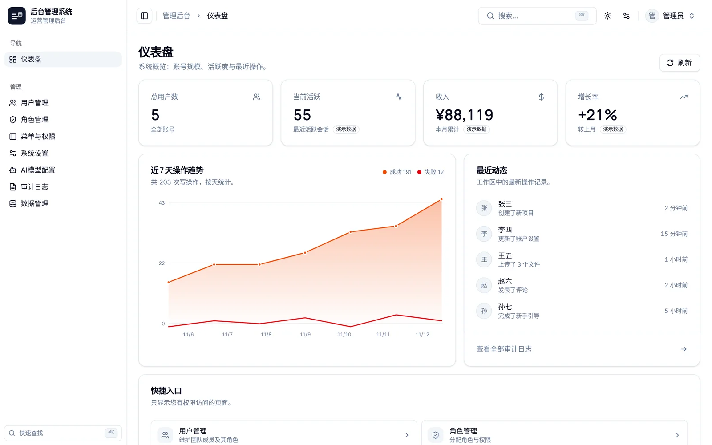

> **简体中文** ｜ [English](../en/README.md)

# 全栈工坊 · Fullstack Forge

全栈应用脚手架 —— 一条命令生成包含完整后台管理功能的系统。前端 React / Vue / Svelte 任选，后端 FastAPI / Spring Boot 任选，六种组合共用同一份接口契约与视觉规范。生成器本身发布为 npm 包 `create-fullstack-app`。



登录页 / 用户管理 / 系统设置 / 审计日志等界面见 [README](../../README.md)，文档站 <https://fullstack.hmilyld.com> 有逐模块说明。

## 功能

- 🎨 **前端可选**：React 19 (Vite + TypeScript + Tailwind CSS v4 + shadcn/ui，含 PWA，站点名/描述/主题色自动适配) 、Vue 3 (Vite + TypeScript + Tailwind CSS v4 + shadcn-vue + Reka UI，含 PWA，站点名/描述/主题色自动适配) 或 Svelte 5 (SvelteKit 3 + Vite + TypeScript + Tailwind CSS v4 + shadcn-svelte + Bits UI，含 PWA，站点名/描述/主题色自动适配)
- ⚙️ **后端可选**：Python (FastAPI) 或 Java (Spring Boot)
- 🔐 **内置认证**：登录、注册、登出（Python 走 JWT，Java 走 Sa-Token）、维护模式与人工审核
- 🧩 **完整模块**：用户、角色、权限、菜单、系统设置、AI 模型与预设、审计日志、数据管理、仪表盘
- 🐳 **Docker 就绪**：单镜像部署，Nginx 反代
- 📊 **开箱即用**：仪表盘统计、用户/角色/权限 CRUD、分页搜索、个人设置
- 🧭 **列表与交互**：列显隐与表格密度（按表记忆）、每页条数、表头吸顶、多选批量、⌘K 命令面板（含最近访问）、外观抽屉（主题 / 侧栏样式 / 折叠方式）、表单未保存离开提示
- 🎛 **界面规范**：蓝灰中性色 + 深藏蓝主色、Inter / Manrope 字体、6/8/10/14/18 圆角阶梯，设计令牌与组件规范见 `templates/frontend-react/DESIGN.md`（三套同构）
- 🗓 **日期时间控件**：自绘中文月历 + 时分输入（不用原生 `datetime-local`，避免英文格式与跨浏览器盒模型差异）

## 生成的项目功能

| 模块 | 功能 |
|------|------|
| 登录认证 | token 登录、注册、登出、登录/注册速率限制、401 自动登出 |
| 仪表盘 | 统计卡片 + 近 7 天操作趋势（自绘 SVG，无图表依赖）+ 最近动态 + 快捷入口 |
| 用户管理 | 列表 + 分页 + 搜索 + 详情 + 新增/编辑 + 删除 + 重置密码 + 批量改角色 |
| 角色管理 | 列表 + 分页 + 搜索 + 新增/编辑（宽弹窗权限树表格）+ 删除（预设角色不可删除，删除时其下用户自动转交默认角色） |
| 权限总览 | 只读查看菜单权限 + 操作权限；操作权限在「菜单与权限」中维护，启动时自动与权限目录同步 |
| 菜单与权限 | 树形表格维护分组与菜单、显示/隐藏、跨组拖拽、拖拽即保存、每个菜单下的操作权限管理、权限过滤动态侧边栏 |
| 系统设置 | 站点配置读写、邮件测试、维护模式（拦截非管理员登录）、开放注册、人工审核 |
| AI 模型 | 列表/默认/按别名查询/详情/新增/编辑/删除/连接测试 |
| AI 模型预设 | 分组、激活预设、列表/新增/编辑/删除 |
| 审计日志 | 写操作与权限拦截记录，按用户/状态/动作/时间筛选，分页查看 |
| 数据管理 | AES 加密完整导出、同版本完整导入、导入期间全局冻结、全部会话失效 |
| 个人中心 | 修改资料、修改密码 |
| 访问适配 | 手机、平板、电脑自适应：`< 768px` 卡片列表 + 抽屉导航，`768–1279px` 图标栏，`≥ 1280px` 完整侧边栏；低于 1280 默认收起（含运行时缩窗） |
| 列表与交互 | 列显隐与表格密度（按表记忆）、每页条数、表头吸顶、多选批量操作、手机卡片列表；⌘K 命令面板（空查询先列最近访问）；外观抽屉；表单未保存离开提示；自绘日期时间选择器 |

默认账号：`admin / 123456`（唯一管理员）；`zhangsan / lisi / wangwu / zhaoliu` 密码均为 `123456`（普通用户）。注册新账号时根据系统设置进入「待审核」或「普通用户」角色。

接口鉴权基于权限点（RBAC）：默认 `admin` 角色拥有全部权限；`user`（普通用户）角色仅有 `dashboard`、`users`、`settings` 三个菜单查看权限；`pending_review`（待审核）无任何权限。

## 本项目结构

```
fullstack-starter/
├── package.json                # npm 包配置
├── tsconfig.json               # TypeScript 编译配置
├── README.md                   # 本文件
├── src/
│   ├── index.ts                # CLI 入口（交互式选择前端/后端/项目名）
│   └── generator.ts            # 项目生成器（复制模板 + 动态生成配置文件）
└── templates/
    ├── base/                   # 基础模板（.gitignore）
    ├── frontend-react/         # React 前端完整模板
    ├── frontend-vue/           # Vue 前端完整模板
    ├── frontend-svelte/        # Svelte 前端完整模板
    ├── backend-python/         # Python FastAPI 后端完整模板
    └── backend-java/           # Java Spring Boot 后端完整模板
```

## 快速使用

### 安装 & 构建

```bash
npm install
npm run build
```

### 运行

```bash
# 开发模式（跳过编译，直接运行 TypeScript）
npm run dev

# 或者编译后运行
node dist/index.js
```

### 交互式选择

```
? 请选择前端框架: (Use arrow keys)
  ❯ React
    Vue
    Svelte

? 请选择后端框架: (Use arrow keys)
  ❯ Python (FastAPI)
    Java (Spring Boot)

? 请输入项目名称: my-project
```

生成的项目会出现在当前目录下。

## 生成的项目结构

```
my-project/
├── frontend/                # 前端项目
│   ├── src/
│   │   ├── api/             # API 调用层（http.ts 基础设施 + client.ts + 按业务域拆分的调用文件）
│   │   ├── types/           # 类型定义（按业务域拆分）
│   │   ├── pages/           # React/Vue 页面：auth、dashboard、settings/{user,role,permission,menu,system,ai-model,audit-log,data-management,profile}
│   │   ├── components/      # 共享组件（shared/ + ui/ 组件库）
│   │   ├── router(.tsx 或 /index.ts)  # React/Vue 路由（受保护路由）
│   │   └── stores/ 或 lib/  # 全局状态（React: lib/，Vue: stores/）
│   │   # Svelte：页面在 src/routes/，共享代码、hooks、stores 在 src/lib/
│   ├── vite.config.ts       # 开发代理 /api → localhost:8088
│   └── package.json
├── backend/                 # 后端项目
│   ├── app/                 # Python FastAPI（core + auth/user/role/permission/menu/system/dashboard/ai_model/audit/data_management/public）
│   └── src/main/java/...    # Java Spring Boot（controller/service/repository/entity/config/common/security/dto）
├── dev.sh                   # 开发脚本（start/stop/restart/install）
├── build.sh                 # 构建脚本
├── Dockerfile               # 单镜像：前端构建 + 后端 + Nginx
├── docker-compose.yml       # Docker 编排
├── .dockerignore            # Docker 构建排除项
├── nginx.conf               # Nginx 配置（反代 /api → 后端）
└── README.md
```

## 端口配置

| 环境 | 前端 | 后端 |
|------|------|------|
| 开发 | 5173 | 8088 |
| Docker | 5173 | 8088 |

## 开发指南

### 修改模板

直接编辑 `templates/` 下的文件，就像修改普通项目一样。模板文件即用户最终拿到的文件。

```bash
# 示例：给 React 前端加一个日志页面
touch templates/frontend-react/src/pages/log/LogList.tsx
# 然后在 router.tsx 添加路由、api/ 添加 API 调用，最后在「菜单与权限」页新增菜单并给角色授权
```

### 新增模板

```bash
# 1. 创建模板目录
mkdir -p templates/frontend-svelte

# 2. 在里面搭建完整项目

# 3. 修改 src/generator.ts
#    - 更新 FrontendType / BackendType 类型
#    - 更新 index.ts 的 choices 数组
#    - 更新 generator.ts 中的 Dockerfile 生成逻辑
```

### 测试

```bash
npm run dev
# 选择前端/后端/项目名，生成后验证：
cd <生成的项目>/frontend && npm install && npm run build
cd <生成的项目>/frontend && npm test && npx playwright install chromium && npm run test:e2e
cd <生成的项目>/backend && 启动后端
```

## 技术栈

| 组件 | React 模板 | Vue 模板 | Svelte 模板 |
|------|-----------|---------|------------|
| 框架 | React 19 | Vue 3.5+ (Composition API) | Svelte 5 (runes) |
| 构建 | Vite | Vite | SvelteKit 3 + Vite |
| 语言 | TypeScript | TypeScript | TypeScript |
| 样式 | Tailwind CSS v4 + shadcn/ui（含 PWA） | Tailwind CSS v4 + shadcn-vue + Reka UI（含 PWA） | Tailwind CSS v4 + shadcn-svelte + Bits UI（含 PWA） |
| HTTP | 原生 fetch 封装（401 自动登出） | 原生 fetch 封装（401 自动登出） | 原生 fetch 封装（401 自动登出） |
| 路由 | react-router v7 | vue-router v5 | SvelteKit 文件路由 |
| 状态 | React Context (lib/) | Pinia (stores/) | runes (stores/) |
| 图标 | lucide-react | @lucide/vue | @lucide/svelte |

| 组件 | Python 模板 | Java 模板 |
|------|------------|----------|
| 框架 | FastAPI | Spring Boot 3.2 |
| ORM | SQLAlchemy 2.0 (async) | Spring Data JPA |
| 数据库 | SQLite (aiosqlite，Alembic 迁移) | SQLite 文件 (./data/app.db，Flyway 迁移) |
| 认证 | PyJWT + bcrypt（登出即失效） | Sa-Token（uuid 风格令牌）+ BCrypt |
| 密钥 | 环境变量 `JWT_SECRET_KEY`（弱密钥拒绝启动） | 无需密钥（Sa-Token 服务端会话令牌） |

## 界面规范

三套前端共用同一份设计规范（`templates/frontend-react/DESIGN.md`、`templates/frontend-vue/DESIGN.md`、`templates/frontend-svelte/DESIGN.md`），要点：

- **色彩**：中性色带蓝相（`oklch` hue 256–265），主色深藏蓝，图表使用 5 个语义色；深浅色各一套令牌
- **字体**：正文 Inter，标题 Manrope，等宽用于编码与动作名
- **圆角**：6 / 8 / 10 / 14 / 18，分别对应 sm / md / lg / xl / 2xl，不写一次性魔法值
- **高度**：控件 36px（触屏 44px），图标按钮 32px（触屏 40px）
- **断点**：Compact `< 768px`、Medium `768–1279px`、Expanded `≥ 1280px`；正文最大宽 1536px
- **组件**：`DataList`（列驱动表格 + 卡片 + 状态）、`PageHeader`、`ListShell`、`ColumnToggle`、`DensityToggle`、`DateTimeField`、`ConfigDrawer`、`CommandMenu` 等，三栈保持同构

## API 接口

除文件下载接口外，所有接口返回：`{ code: 0, message: "success", data: ... }`（错误返回 `code: -1`）。`/api/data/export` 成功时直接返回 ZIP 文件。

> 「认证」列中 `是(权限码)` 表示需携带 token 且拥有对应权限点（如 `users`、`users.create`）；仅标 `是` 表示登录即可；Python 版未登录返回 401。两栈行为一致，除 `logout` 外：Java 版未登录调用也返回成功。

### 认证

| 方法 | 路径 | 说明 | 认证 |
|------|------|------|------|
| POST | /api/auth/login | 登录 | 否 |
| POST | /api/auth/register | 注册（受开放注册/人工审核设置控制） | 否 |
| POST | /api/auth/logout | 登出（使当前令牌立即失效） | 是¹ |

### 用户

| 方法 | 路径 | 说明 | 认证 |
|------|------|------|------|
| GET | /api/users | 用户列表（分页+搜索） | 是(users) |
| GET | /api/users/:id | 用户详情 | 是(users) |
| POST | /api/users | 创建用户 | 是(users.create)² |
| PUT | /api/users/:id | 更新用户 | 是(users.edit) |
| DELETE | /api/users/:id | 删除用户 | 是(users.delete) |
| PUT | /api/users/:id/reset-password | 重置密码 | 是(users.edit) |
| POST | /api/users/batch-role | 批量设置角色 | 是(users.edit 或 users.assign_role) |
| PUT | /api/users/me | 修改个人资料 | 是 |
| PUT | /api/users/me/password | 修改密码 | 是 |

### 角色与权限

| 方法 | 路径 | 说明 | 认证 |
|------|------|------|------|
| GET | /api/roles | 角色列表（分页+搜索） | 是(roles) |
| POST | /api/roles | 创建角色 | 是(roles.create) |
| PUT | /api/roles/:id | 更新角色 | 是(roles.edit) |
| DELETE | /api/roles/:id | 删除角色（预设角色不可删；其下用户转交默认角色） | 是(roles.delete) |
| GET | /api/permissions | 权限列表 | 是(permissions) |
| POST | /api/permissions | 创建操作权限 | 是(permissions.create)³ |
| POST | /api/permissions/sync | 与权限目录同步 | 是(permissions.create) |
| PUT | /api/permissions/:code | 更新操作权限 | 是(permissions.edit)³ |
| DELETE | /api/permissions/:code | 删除操作权限 | 是(permissions.delete)³ |

### 菜单与权限

| 方法 | 路径 | 说明 | 认证 |
|------|------|------|------|
| GET | /api/menus/navigation | 当前用户动态侧边栏 | 是 |
| GET | /api/menus | 菜单配置、操作权限与当前布局版本 | 是(menus 或 permissions) |
| POST | /api/menus/groups | 创建自定义分组 | 是(menus.create) |
| PUT | /api/menus/groups/:id | 重命名分组 | 是(menus.edit) |
| DELETE | /api/menus/groups/:id | 删除空的自定义分组 | 是(menus.delete) |
| POST | /api/menus/items | 创建自定义菜单及对应权限 | 是(menus.create) |
| PUT | /api/menus/items/:code | 编辑菜单名称、分组、路由、图标或显示状态 | 是(menus.edit) |
| DELETE | /api/menus/items/:code | 删除自定义菜单、其操作权限及授权 | 是(menus.delete) |
| PUT | /api/menus/layout | 原子保存分组和菜单顺序 | 是(menus.reorder) |

### 仪表盘

| 方法 | 路径 | 说明 | 认证 |
|------|------|------|------|
| GET | /api/dashboard/stats | 统计卡片 | 是(dashboard) |
| GET | /api/dashboard/activity | 近期活动 | 是(dashboard) |

### 系统设置

| 方法 | 路径 | 说明 | 认证 |
|------|------|------|------|
| GET | /api/system/config | 读取配置 | 是(settings) |
| PUT | /api/system/config | 更新配置 | 是(settings.edit) |
| POST | /api/system/test-email | 测试邮件 | 是(settings.edit) |
| GET | /api/public/config | 公开配置（登录页用） | 否 |

### AI 模型

| 方法 | 路径 | 说明 | 认证 |
|------|------|------|------|
| GET | /api/ai-models | 模型列表 | 是(ai_models) |
| POST | /api/ai-models | 创建模型 | 是(ai_models.create) |
| GET | /api/ai-models/default | 默认模型 | 是(ai_models) |
| GET | /api/ai-models/by-alias/:alias | 按别名查询 | 是(ai_models) |
| GET | /api/ai-models/:id | 模型详情 | 是(ai_models) |
| PUT | /api/ai-models/:id | 更新模型 | 是(ai_models.edit) |
| DELETE | /api/ai-models/:id | 删除模型 | 是(ai_models.delete) |
| POST | /api/ai-models/test | 连接测试 | 是(ai_models) |
| GET | /api/ai-models/presets | 预设列表 | 是(ai_models) |
| GET | /api/ai-models/presets/groups | 预设分组 | 是(ai_models) |
| GET | /api/ai-models/presets/active | 当前激活预设 | 是(ai_models) |
| GET | /api/ai-models/presets/:id | 预设详情 | 是(ai_models) |
| POST | /api/ai-models/presets | 创建预设 | 是(ai_models.create 或 ai_models.presets.create) |
| PUT | /api/ai-models/presets/:id | 更新预设 | 是(ai_models.edit 或 ai_models.presets.edit) |
| DELETE | /api/ai-models/presets/:id | 删除预设 | 是(ai_models.delete 或 ai_models.presets.delete) |

### 审计日志

| 方法 | 路径 | 说明 | 认证 |
|------|------|------|------|
| GET | /api/audit-logs | 审计日志列表（按用户/状态/动作/时间筛选+分页） | 是(audit_logs) |

### 数据管理

| 方法 | 路径 | 说明 | 认证 |
|------|------|------|------|
| POST | /api/data/export | 下载加密完整导出包 | 是(data_management.export) |
| POST | /api/data/import | 上传并创建完整导入任务 | 是(data_management.import) |
| GET | /api/data/import/:id | 使用一次性任务令牌查询导入状态 | 一次性任务令牌 |

导出包只支持同后端、同应用版本、同数据库结构恢复。包内包含 `manifest.json`、`schema.sql`、`checksums.sha256` 和各业务表的 JSONL 数据；运行时 `app_state` 不进入导出包。导入成功后更新全局会话世代，所有已登录用户必须重新登录。

> 注 1：Python 版 logout 需登录；Java 版兼容未登录调用。
> 注 2：创建非默认角色的用户还需 `users.assign_role` 权限。
> 注 3：以权限 API 对 `menu` 类型权限执行创建/更新/删除会被拒绝（返回 `code: -1`），菜单权限请通过上文的「菜单与权限」接口维护。`menu_items.hidden` 只控制侧边栏显示，不改变权限。

## 许可证

MIT
